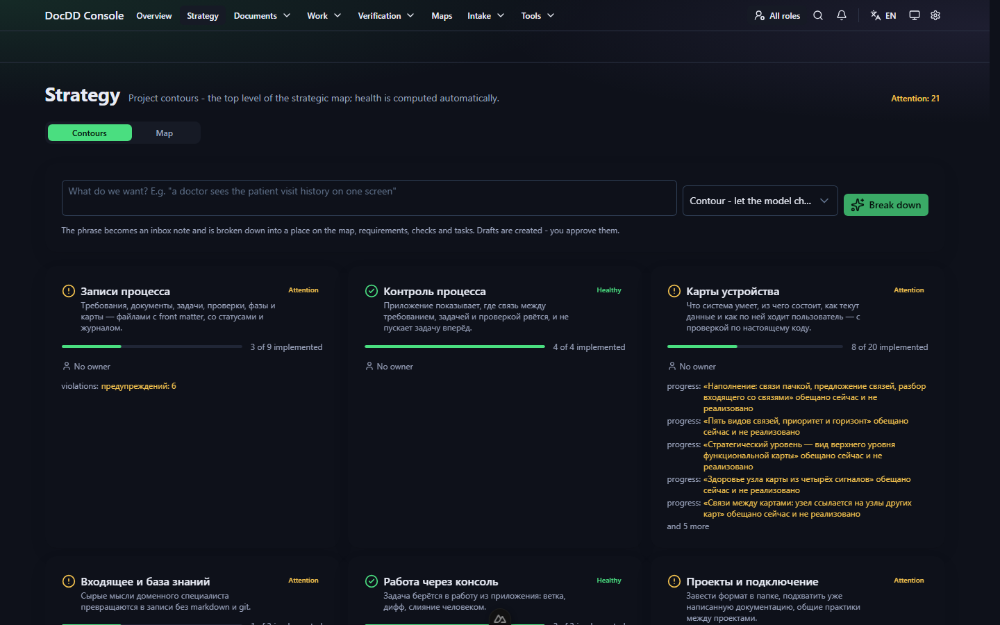
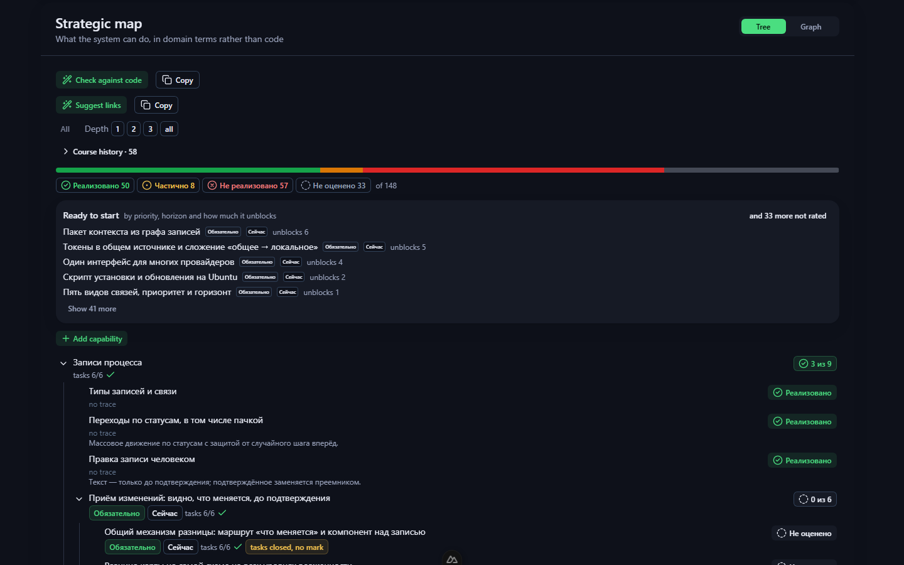
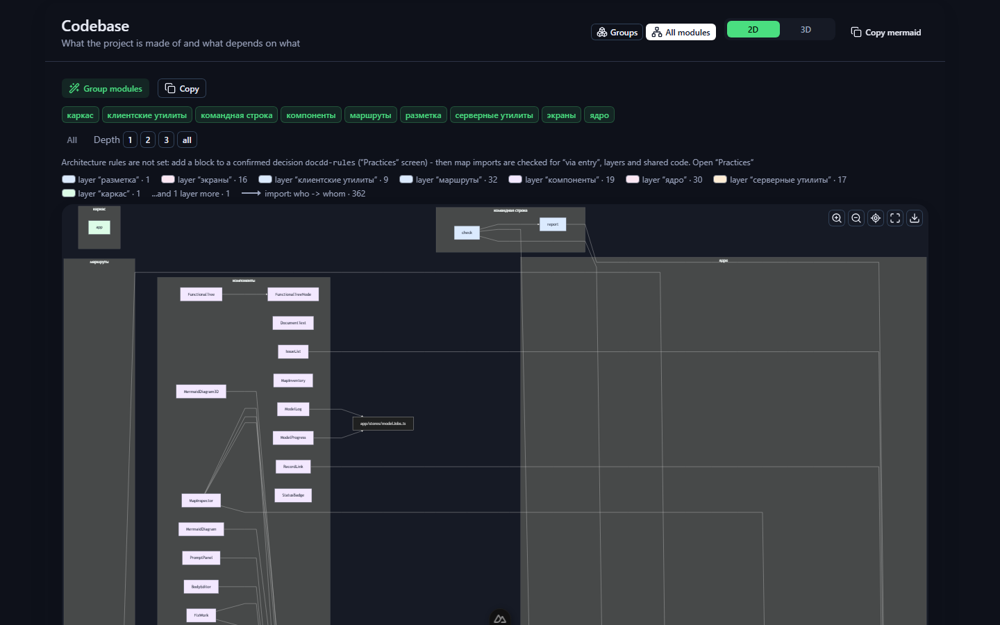
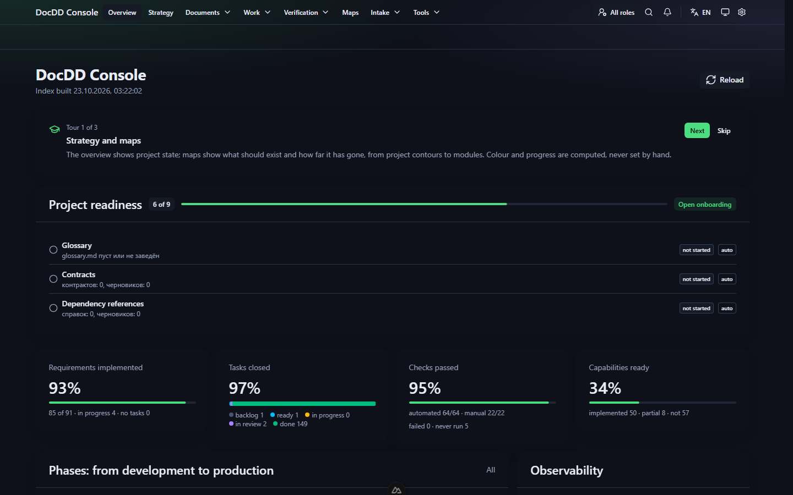

# DocDD Console

[English](README.md) · **Русский**

**Documentation Driven Development, который нельзя обойти.** Локальная веб-консоль: читает записи
процесса проекта — требования, задачи, проверки, решения и карты, обычный markdown в git — и не
даёт начать задачу, пока документы под ней не подтвердил человек.

[](LICENSE)




## Зачем

Документация расходится с кодом, потому что порядок неправильный: сначала меняют код, документ —
«потом». С ИИ код пишется быстрее, и расхождение растёт быстрее. DocDD переворачивает порядок и
делает его проверяемым машиной:

```
намерение → правка документа → подтверждение человеком → код → сверка
```

- Задача не уходит в **готовые**, пока требование под ней не **подтверждено** — не показано, а
  подтверждено.
- ИИ-агенты пишут код в ветке задачи, но **не подтверждают документы** и не принимают свою же
  работу. Сливает человек — перемоткой, без переписывания истории и без отправки на сервер.
- После слияния код **сверяется с картами**: у каждой связи на карте есть файл и строка.

По духу это близко к spec-driven development (Spec Kit, Kiro), но с двумя дополнениями: человек
подтверждает спецификацию до начала работы, а после — код сверяется с картами.

## Что внутри

- **Записи процесса — файлы.** Требования, задачи, проверки, фазы, решения, контракты и справки
  лежат в `docs/development` *вашего* репозитория (контракт `docdd.workspace/1`). Базы данных нет:
  удалите кэш — ничего не потеряется ([ADR-0001](docs/adr/0001-files-are-the-truth.md)).
- **Проверки.** Схемы, ссылочная целостность и правила процесса: «задача в работе с
  неподтверждённым документом», «требование без единой проверки», «закрытая задача с
  проваленным тестом».
- **Стратегическая карта.** Одна на проект: вектор наверху, ниже контуры, дальше дерево
  возможностей любой глубины. Здоровье контура считается само из прогресса, сроков, качества
  проверок и нарушений — руками не ставится.
- **Рабочие карты.** Кодовая база, потоки данных, пользовательские пути — или свои карты из
  шаблонов. У связей есть свидетельства (`файл:строка` и фрагмент), они сверяются с кодом.
- **«Что хотим?»** Одна фраза на стратегической карте раскладывается моделью на место в карте,
  требования, проверки и задачи — черновиками, которые подтверждаете вы.
- **Работа через консоль.** У задачи своя ветка и рабочее дерево; модель пишет код, вы смотрите
  дифф и сливаете.
- **Агенты ролей с ограничениями.** Агент — аккаунт с ролью: не подтверждает, не принимает свою
  работу, подписывается в журнале, у задачи есть бюджет токенов.
- **Проверка из командной строки.** `npm run check -- <проект>` роняет сборку на нарушении процесса.

| Стратегическая карта | Карта кодовой базы |
|---|---|
|  |  |



> На скриншотах DocDD ведёт собственную разработку; интерфейс снят на английском.

## Запуск

Нужен Node.js `^20.19` или `>=22.12`.

```bash
git clone https://github.com/chelowek054-lgtm/docdd-console.git
cd docdd-console
npm install
npm run build
npm run start:built
```

Откройте `http://127.0.0.1:3000`, добавьте папку проекта и укажите существующий
`docs/development` или дайте консоли завести его. Для правки самой консоли — `npm run dev`
(страницы грузятся медленнее: dev-сервер отдаёт около 240 модулей на каждую полную загрузку).

**Модель не обязательна.** Всё, что читает, проверяет и показывает, работает без неё. Разбор
намерений, описание карт и работа над задачами идут через [Claude Code](https://claude.com/claude-code)
на той же машине или через чат-провайдера (Anthropic или совместимый с OpenAI API), подключённого
в консоли.

Сервер слушает только `127.0.0.1` и не читает и не пишет за пределами объявленного корня проекта.
Для общего сервера Ubuntu есть скрипт установки с nginx и авторизацией —
[docs/14-deploy.md](docs/14-deploy.md).

## Проверка проекта из командной строки

Тот же валидатор без браузера — чтобы сборка падала на нарушении процесса раньше, чем кто-нибудь
откроет экран:

```bash
npm run check -- /путь/к/проекту
npm run check -- /путь/к/проекту --json
```

Код возврата `1` — есть ошибка, `2` — проект не прочитан, `0` — чисто. Предупреждения выводятся,
но сборку не валят. Проверка ничего не пишет: ни файлов, ни кэша.

## Репозиторий о самом себе

DocDD разрабатывается по DocDD: в `docs/development` лежат собственные требования, задачи,
проверки и карты проекта, а `tests/self-map.spec.ts` роняет сборку, если код уехал из-под карты.

```bash
npm run check -- .
npm run typecheck && npm run test && npm run lint
```

## Документация

| Документ | О чём |
|---|---|
| [docs/00-overview.md](docs/00-overview.md) | Зачем приложение, границы, чего оно не делает |
| [docs/01-architecture.md](docs/01-architecture.md) | Из чего состоит: серверная часть Nitro и интерфейс |
| [docs/02-workspace-contract.md](docs/02-workspace-contract.md) | Формат файлов, которые приложение читает и пишет |
| [docs/03-server-api.md](docs/03-server-api.md) | Внутренний HTTP-контракт между интерфейсом и сервером |
| [docs/04-ui.md](docs/04-ui.md) | Экраны, состояния, навигация |
| [docs/05-validation.md](docs/05-validation.md) | Проверки, коды нарушений, серьёзность |
| [docs/06-phases.md](docs/06-phases.md) | Фазы реализации и признаки готовности |
| [docs/07-maps.md](docs/07-maps.md) | Стратегическая и рабочие карты, свидетельства, сверка |
| [docs/08-usage.md](docs/08-usage.md) | Как пользоваться, правила реализации |
| [docs/09-execution.md](docs/09-execution.md) | Выполнение задачи через консоль: ветка, дифф, слияние |
| [docs/14-deploy.md](docs/14-deploy.md) | Установка на общий сервер Ubuntu |
| [docs/15-team-platform.md](docs/15-team-platform.md) | Курс на платформу команды вместо Jira и Confluence |
| [docs/16-design-system.md](docs/16-design-system.md) | Единый дизайн: токены, выгрузка в стеки, проверка экранов |
| [docs/prompts/](docs/prompts/) | Шаблоны запросов к модели |
| [docs/adr/](docs/adr/) | Решения с причинами и отвергнутыми вариантами |
| [docs/schemas/](docs/schemas/) | JSON Schema, по которым идёт проверка |

## Стек

Nuxt 4 (TypeScript), серверная часть Nitro для доступа к файлам, Nuxt UI как дизайн-система, Ajv
для проверки схем, `gray-matter` и `js-yaml` для разбора файлов, mermaid для диаграмм.

## Участие

Issues и пулл-реквесты приветствуются — сначала прочитайте [CONTRIBUTING.md](CONTRIBUTING.md):
репозиторий живёт по собственному правилу, и изменение поведения начинается с правки документа.
Уязвимости — по [SECURITY.md](SECURITY.md).

## Лицензия

[Apache License 2.0](LICENSE).
