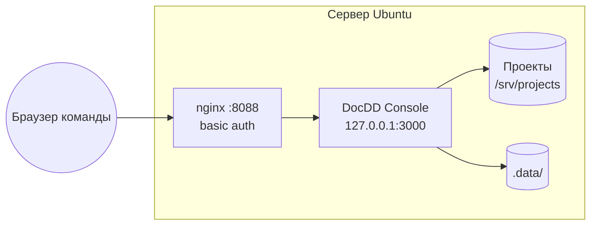

# Развёртывание на сервере

Приложение можно поставить на общий сервер Ubuntu, чтобы команда смотрела прогресс в
браузере. Решение и отвергнутые варианты — [adr/0018-shared-server.md](adr/0018-shared-server.md);
курс объявлен картой M-0007.

Скрипт — [`deploy/deploy.sh`](../deploy/deploy.sh); запуск: `sudo REPO_URL=… ./deploy/deploy.sh`.

## Что нужно серверу

- Ubuntu 22.04 или новее, доступ `root` или `sudo`.
- Доступ к интернету на время установки: `nodejs.org`, реестр npm, репозиторий. Репозиторий
  закрытый — вход в него нужен пользователю `APP_USER` (ключ в `/var/lib/<APP_USER>/.ssh`
  и ссылка `git@…`, либо токен в `REPO_URL`; токен виден в `.git/config`).
- Свободный порт для nginx (по умолчанию 8088). Порт 80 скрипт **не занимает**.
- Для кнопок модели — Claude Code под пользователем сервиса (см. ниже). Остальное работает без него.

## Схема

Сервис слушает только `127.0.0.1`; снаружи его видит только nginx.

## Параметры

Скрипт читает переменные окружения. Обязателен один — `REPO_URL`.

| Переменная | По умолчанию | Что значит |
|---|---|---|
| `REPO_URL` | — | Откуда клонировать приложение |
| `BRANCH` | `main` | Какую ветку ставить |
| `APP_DIR` | `/opt/docdd-console` | Куда клонировать и где собирать |
| `APP_USER` | `docdd` | Пользователь сервиса: без входа в систему, домашний каталог — `/var/lib/<APP_USER>` |
| `NODE_VERSION` | из `.nvmrc` | Версия Node; пусть в репозитории лежит `22`, скрипт берёт последнюю 22.x |
| `APP_PORT` | `3000` | Порт сервиса на `127.0.0.1` |
| `PUBLIC_PORT` | `8088` | Порт nginx снаружи |
| `SERVER_NAME` | `_` | Имя сервера в nginx |
| `AUTH_USER` | `docdd` | Логин basic auth |
| `AUTH_PASSWORD` | создаётся | Пароль; не задан — генерируется при первой установке и печатается один раз |
| `PROJECTS_DIR` | `/srv/projects` | Каталог для проектов, принадлежит `APP_USER` |

## Что делает скрипт

Повторный запуск безопасен: каждый шаг проверяет, что уже сделано, и обновляет только
нужное.

1. Проверяет, что запущен от `root`, что система — Ubuntu, что `REPO_URL` задан, что порты
   числа и не равны 80, что `PUBLIC_PORT` и `APP_PORT` не заняты чужими процессами.
2. Ставит `git`, `curl`, `xz-utils`, `openssl`, `nginx`, `apache2-utils` (для `htpasswd`). Пока
   nginx ставится с нуля, запуск служб на время установки запрещён: иначе он стартует на
   занятом Docker порту 80, и пакет остаётся недонастроенным.
3. Заводит `APP_USER` (системный, без входа; домашний каталог `/var/lib/<APP_USER>`) и
   `PROJECTS_DIR`. Если у пользователя не задано имя для git, ставит «DocDD Console»:
   приложение коммитит от его имени, и без имени git откажет.
4. Клонирует репозиторий или обновляет его (`git fetch` и перемотка на `BRANCH` без слияний;
   если у рабочей копии есть свои изменения — остановка с сообщением, а не затирание).
   Раньше Node: версию читает из клона, из `.nvmrc`.
5. Скачивает **Node** с nodejs.org в `/opt/node-<версия>`, сверяет контрольную сумму по
   `SHASUMS256.txt` и переключает ссылку `/opt/node` на неё. Подпись GPG не проверяется,
   только сумма с того же сайта. Без nvm и сторонних репозиториев; старые версии не удаляет.
   Версия вне диапазона из `engines` (`^20.19.0 || >=22.12.0`) — остановка.
6. `npm ci` и `npm run build` под `APP_USER`.
7. Пишет юнит systemd `docdd-console.service` и перезапускает его с `NITRO_HOST=127.0.0.1`,
   `NITRO_PORT=<APP_PORT>`. В `PATH` сервиса входит `/var/lib/<APP_USER>/.local/bin`, куда
   ставится Claude Code; путь можно назвать и переменной `DOCDD_CLAUDE_PATH`.
8. Создаёт файл паролей `/etc/nginx/docdd.htpasswd` (bcrypt), если его нет. Пароль не задан —
   генерируется и печатается один раз. Файл есть, а `AUTH_PASSWORD` задан — пароль
   `AUTH_USER` обновляется.
9. Пишет **один** файл `/etc/nginx/conf.d/docdd-console.conf` и включает его. Стандартный
   сайт nginx отключает только у nginx, который поставил сам (или который не смог стартовать
   из-за него в прошлый запуск): он слушает 80, и nginx не стартовал бы. Работающий чужой
   nginx и его сайты не трогает. Если включён `ufw`, открывает `PUBLIC_PORT`.
10. Проверяет `nginx -t`, перезагружает nginx, ждёт ответа сервиса до минуты (не ответил —
    выводит строки журнала и завершается с ошибкой) и убеждается, что nginx без пароля
    отвечает `401`: если нет, установка считается неудачной.

Конфигурация nginx отключает буферизацию ответа и поднимает время ожидания чтения:
запрос к модели идёт потоком и может занимать минуты.

## Обновление

Тот же скрипт, та же команда: он подтягивает ветку, пересобирает и перезапускает сервис.
Пароль и данные не трогаются.

## Где что лежит

| Что | Где | Можно удалить |
|---|---|---|
| Приложение и сборка | `APP_DIR` | Да, пересоздаётся скриптом |
| Список проектов | `APP_DIR/.data/` | Нет — единственные собственные данные приложения |
| Проекты | `PROJECTS_DIR/<проект>` | Нет — это источник правды |
| Рабочие деревья задач | `<проект>/.docdd/worktrees/` | Нет, пока задача в работе |
| Кэш | `<проект>/.docdd/index.json` | Да, без последствий |
| Версии Node | `/opt/node-<версия>` | Старые — да |

Проект подключается в приложении по пути на сервере, например `/srv/projects/learning`.
Клонирует его человек, под `APP_USER`.

## Модель на сервере

Кнопки модели вызывают Claude Code на той же машине ([adr/0008-llm-through-claude-code.md](adr/0008-llm-through-claude-code.md)).
Скрипт его не ставит и не авторизует: установка и вход делаются вручную, под `APP_USER` (`sudo -u docdd -H claude`; оболочки у пользователя нет, поэтому через `sudo`). Без него
остальные экраны работают, а кнопка модели честно сообщает, что запуск не удался.

## Безопасность

- Приложение умеет менять документы, запускать модель, коммитить и сливать ветки. Поэтому
  доступ в сеть без авторизации скрипт не ставит, а пароль не хранится в репозитории.
- Basic auth — общий вход, а не учётные записи: кто что сделал, он не покажет. Роли и
  исполнитель задачи — отдельная возможность (`access.roles`), она заменит этот вход.
- Без TLS пароль идёт по сети открытым текстом. Для внешней сети поставьте сертификат
  перед nginx; скрипт этого не делает.
- Остаётся в силе правило из [01-architecture.md](01-architecture.md): сервер работает только
  внутри объявленного корня проекта.
