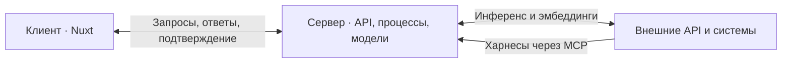

# System Design: устройство DocDD и рабочая вкладка LLM

Карта описывает текущую архитектуру по коду и показывает точки подключения проектируемой вкладки. Существующие узлы сверяются с путями в репозитории. Узлы будущей вкладки добавляют к карте M-0106 контекст остальной системы. Схема верхнего уровня:



## Как разделены модули

Уровень обзора показывает границы клиента, сервера и соседних систем. Внутри сервера группы отражают ответственность: пространство проекта, процесс разработки, знания и карты, модели, дизайн. Например, разбор записей и контроль готовности принадлежат разным группам, хотя оба используют один снимок. Вложенность обозначена полем `parent` со стабильным ID. Группа на карте может объединять модули одного процесса без отдельного развёртывания.

- У каждого узла указана ответственность. У существующих модулей есть `realized_by` с путями к точкам входа и основным компонентам. Связь показывает направление и передаваемые данные или команду.
- Глубина раскрытия зависит от задачи. Экран отвечает на вопрос «где находится ответственность?», а лист ведёт к коду или контракту.
- Практики: [C4 — уровни архитектуры](https://c4model.com/diagrams), [AWS — границы по возможностям](https://docs.aws.amazon.com/prescriptive-guidance/latest/modernization-decomposing-monoliths/decompose-business-capability.html), [Shopify — опыт границ внутри монолита](https://shopify.engineering/a-packwerk-retrospective).

## Сценарии рабочей вкладки

- **Разработка.** Намерение → уточнения → проект требований, задачи, карты и проверки → подтверждение → существующий механизм выполнения в рабочем дереве → проверки и приёмка. Локальная модель передаёт патч и результаты через управляемые операции DocDD.
- **Исследование.** Вопрос → поиск по проекту → разрешённый веб-ресерч при необходимости → выводы с источниками → черновик в DocDD.
- **Разбор существующего проекта.** Локальная модель читает разрешённый код и документы, связывает выводы с путями и свидетельствами, предлагает дополнения к картам, справкам и контрактам. Изменения идут через DocDD и проверяются человеком.

Для всех трёх сценариев переиспользуются сборщик контекста, очередь заданий и рабочий процесс DocDD. Мультимодальность, рабочая папка, границы внешнего поиска и полномочия записи описаны в [M-0106](M-0106-lokalnyy-pomoschnik-system-design.md).

## Ожидаемое поведение графа

- При открытии видны три группы верхнего уровня и связи между ними. Двойной щелчок или кнопка «Открыть группу» раскрывают непосредственных потомков на любой глубине. Одиночный щелчок открывает сведения об узле. Хлебные крошки и «Назад» возвращают на нужный уровень.
- Связи между скрытыми потомками сворачиваются по видимым группам с количеством и подписями. При входе в группу сохраняются входящие и исходящие связи с внешними узлами. Группировка не меняет сохранённый тип и направление исходных связей.
- Vue Flow и elkjs дают начальное размещение. Пользователь может перемещать холст и узлы, менять масштаб и восстановить авторазмещение. Позиции сохраняются как предпочтение вида проекта отдельно от записей карты.
- Пометки «Сейчас» и «Запланировано» видны на узлах. Режим «Сейчас» скрывает проектируемые компоненты. Старые записи без `parent` остаются на верхнем уровне. Линтер сообщает о пропавших родителях и циклах.
- Приёмка: пройти «Сервер → Рабочая сессия LLM → Поиск и сборка контекста → Локальный индекс», вернуться на уровень сервера, проверить внешнюю связь с моделью, затем переместить узел и открыть карту снова. Отдельно проверить переход от существующего модуля к его пути в коде.

На данный момент вкладка передаёт все узлы в один холст. Для интерактивных уровней нужно связать `parent` со штатной логикой иерархии из `server/lib/hierarchy.ts` и применить её проекцию до отрисовки System Design.

```docdd-sysdesign
{
  "added": {
    "nodes": [
      {
        "id": "client",
        "title": "Клиент",
        "kind": "ui",
        "detail": "template",
        "realized_by": [],
        "reference": "Браузер Nuxt. Проектные экраны, состояние и взаимодействие с API.",
        "state": "group"
      },
      {
        "id": "server",
        "title": "Сервер",
        "kind": "container",
        "detail": "template",
        "realized_by": [],
        "reference": "Nitro, команды CLI и серверные модули DocDD. Логическая группа карты.",
        "state": "group"
      },
      {
        "id": "external",
        "title": "Внешние API и системы",
        "kind": "system",
        "detail": "template",
        "realized_by": [],
        "reference": "Модельные сервисы и инструменты за границей процесса DocDD.",
        "state": "group"
      },
      {
        "id": "client.projects",
        "parent": "client",
        "title": "Проекты и рабочие экраны",
        "kind": "ui",
        "detail": "template",
        "realized_by": [
          "app/pages/projects/[id]/work.vue",
          "app/pages/projects/[id]/requirements.vue",
          "app/pages/projects/[id]/tasks.vue"
        ],
        "reference": "Требования, задачи, ход работ и доступные действия.",
        "state": "current"
      },
      {
        "id": "client.maps",
        "parent": "client",
        "title": "Карты и навигация",
        "kind": "ui",
        "detail": "template",
        "realized_by": [
          "app/pages/projects/[id]/maps.vue",
          "app/components/SystemDesignPanel.vue",
          "app/components/StandardMapGraph.client.vue"
        ],
        "reference": "Загружает виды карт, показывает узлы и связи. System Design пока выдаёт один граф.",
        "state": "current"
      },
      {
        "id": "client.knowledge",
        "parent": "client",
        "title": "Знания и поиск",
        "kind": "ui",
        "detail": "template",
        "realized_by": [
          "app/pages/projects/[id]/knowledge.vue",
          "app/pages/projects/[id]/search.vue"
        ],
        "reference": "Чтение знаний и навигация по результатам поиска.",
        "state": "current"
      },
      {
        "id": "client.settings",
        "parent": "client",
        "title": "Модели, доступ и учёт",
        "kind": "ui",
        "detail": "template",
        "realized_by": [
          "app/pages/models.vue",
          "app/pages/people.vue",
          "app/pages/usage.vue"
        ],
        "reference": "Управление настройками моделей, людьми и учётом запросов.",
        "state": "current"
      },
      {
        "id": "server.entry",
        "parent": "server",
        "title": "Входы и доступ",
        "kind": "container",
        "detail": "template",
        "realized_by": [],
        "reference": "Входящие запросы браузера и инструментов. Выбор проекта, права и доступ к действиям.",
        "state": "group"
      },
      {
        "id": "server.http",
        "parent": "server.entry",
        "title": "API и права проекта",
        "kind": "component",
        "detail": "template",
        "realized_by": [
          "server/utils/http.ts",
          "server/utils/auth.ts",
          "server/utils/projects.ts"
        ],
        "reference": "HTTP API связывает запрос с проектом и полномочиями.",
        "state": "current"
      },
      {
        "id": "server.mcp",
        "parent": "server.entry",
        "title": "MCP и CLI",
        "kind": "component",
        "detail": "template",
        "realized_by": [
          "cli/mcp.ts",
          "cli/check.ts"
        ],
        "reference": "MCP предоставляет инструменты через API консоли. CLI запускает проверку проекта.",
        "state": "current"
      },
      {
        "id": "server.workspace",
        "parent": "server",
        "title": "Пространство проекта",
        "kind": "container",
        "detail": "template",
        "realized_by": [],
        "reference": "Работает с корнем проекта, записями и производными индексами.",
        "state": "group"
      },
      {
        "id": "server.read",
        "parent": "server.workspace",
        "title": "Снимок проекта",
        "kind": "component",
        "detail": "template",
        "realized_by": [
          "server/lib/workspace.ts",
          "server/utils/index-service.ts"
        ],
        "reference": "Читает манифест, записи, файлы и отчёты проекта.",
        "state": "current"
      },
      {
        "id": "server.records",
        "parent": "server.workspace",
        "title": "Запись документов",
        "kind": "component",
        "detail": "template",
        "realized_by": [
          "server/utils/record-write.ts",
          "server/lib/write.ts"
        ],
        "reference": "Сохраняет допустимые изменения полей и журнала в проекте.",
        "state": "current"
      },
      {
        "id": "server.files",
        "parent": "server.workspace",
        "title": "Файлы проекта",
        "kind": "database",
        "detail": "template",
        "realized_by": [],
        "reference": "Markdown, схемы и отчёты под docs/development. Код и источники задаются манифестом.",
        "state": "current"
      },
      {
        "id": "server.process",
        "parent": "server",
        "title": "Процесс разработки",
        "kind": "container",
        "detail": "template",
        "realized_by": [],
        "reference": "Связывает задачи, требования, решения и проверки. Управляет переходами и исполнением.",
        "state": "group"
      },
      {
        "id": "server.validation",
        "parent": "server.process",
        "title": "Проверка готовности",
        "kind": "component",
        "detail": "template",
        "realized_by": [
          "server/lib/analyze.ts",
          "server/lib/rules.ts",
          "server/lib/transitions.ts"
        ],
        "reference": "Собирает связи и нарушения, вычисляет доступность переходов.",
        "state": "current"
      },
      {
        "id": "server.work",
        "parent": "server.process",
        "title": "Выполнение и приёмка",
        "kind": "component",
        "detail": "template",
        "realized_by": [
          "server/utils/work-service.ts",
          "server/utils/git.ts"
        ],
        "reference": "Рабочие деревья, результат работы, приёмка и итоговое слияние по правилам консоли.",
        "state": "current"
      },
      {
        "id": "server.inbox",
        "parent": "server.process",
        "title": "Входящие и допрос",
        "kind": "component",
        "detail": "template",
        "realized_by": [
          "server/utils/inbox-service.ts",
          "server/utils/grill-service.ts"
        ],
        "reference": "Превращает входящие материалы и ответы в предложения DocDD.",
        "state": "current"
      },
      {
        "id": "server.knowledge",
        "parent": "server",
        "title": "Карты, знания и поиск",
        "kind": "container",
        "detail": "template",
        "realized_by": [],
        "reference": "Формирует представления проекта и отбирает материал для пользователя и модели.",
        "state": "group"
      },
      {
        "id": "server.maps",
        "parent": "server.knowledge",
        "title": "Карты и сверка",
        "kind": "component",
        "detail": "template",
        "realized_by": [
          "server/utils/map-service.ts",
          "server/lib/maps.ts",
          "server/utils/system-design-service.ts"
        ],
        "reference": "Складывает подтверждённые карты, сопоставляет System Design с кодовой картой.",
        "state": "current"
      },
      {
        "id": "server.search",
        "parent": "server.knowledge",
        "title": "Поиск и пакет контекста",
        "kind": "component",
        "detail": "template",
        "realized_by": [
          "server/utils/semantic-service.ts",
          "server/utils/context-service.ts",
          "server/lib/context-pack.ts"
        ],
        "reference": "Ищет по блокам и формирует ограниченный пакет контекста.",
        "state": "current"
      },
      {
        "id": "server.ai",
        "parent": "server",
        "title": "Модели и задания",
        "kind": "container",
        "detail": "template",
        "realized_by": [],
        "reference": "Маршрутизирует запросы, хранит состояние выполнения и учёт расхода.",
        "state": "group"
      },
      {
        "id": "server.gateway",
        "parent": "server.ai",
        "title": "Шлюз моделей",
        "kind": "component",
        "detail": "template",
        "realized_by": [
          "server/utils/llm-gateway.ts",
          "server/utils/llm-providers.ts"
        ],
        "reference": "Выбирает настроенного провайдера и маршрут.",
        "state": "current"
      },
      {
        "id": "server.jobs",
        "parent": "server.ai",
        "title": "Очередь, результаты и учёт",
        "kind": "queue",
        "detail": "template",
        "realized_by": [
          "server/lib/llm-queue.ts",
          "server/utils/llm-jobs-store.ts",
          "server/utils/llm-usage-store.ts"
        ],
        "reference": "Ведение задач модели и учёт запросов.",
        "state": "current"
      },
      {
        "id": "server.design",
        "parent": "server",
        "title": "Дизайн и стандарты",
        "kind": "component",
        "detail": "template",
        "realized_by": [
          "server/utils/design-service.ts",
          "server/utils/design-screens-service.ts",
          "server/utils/design-catalog-service.ts"
        ],
        "reference": "Токены, каталог примеров интерфейса и сверка экранов.",
        "state": "current"
      },
      {
        "id": "external.models",
        "parent": "external",
        "title": "Настроенные провайдеры моделей",
        "kind": "external",
        "detail": "template",
        "realized_by": [],
        "reference": "Инференс и эмбеддинги через доступные на сервере адаптеры.",
        "state": "current"
      },
      {
        "id": "external.harness",
        "parent": "external",
        "title": "Существующие харнесы",
        "kind": "external",
        "detail": "template",
        "realized_by": [],
        "reference": "Могут обращаться к инструментам DocDD через отдельный MCP-процесс.",
        "state": "current"
      },
      {
        "id": "server.local",
        "parent": "server",
        "title": "Рабочая сессия LLM",
        "kind": "container",
        "detail": "template",
        "realized_by": [],
        "reference": "Новая возможность DocDD. Один вход для разработки, исследования и анализа устройства проекта.",
        "state": "planned"
      },
      {
        "id": "server.local.feature",
        "parent": "server.local",
        "title": "Разработка фичи",
        "kind": "component",
        "detail": "template",
        "realized_by": [],
        "reference": "Намерение и уточнения → требования, карта, задача и проверка → согласование → патч в рабочем дереве → проверка и приёмка.",
        "state": "planned"
      },
      {
        "id": "server.local.research",
        "parent": "server.local",
        "title": "Исследование",
        "kind": "component",
        "detail": "template",
        "realized_by": [],
        "reference": "Вопрос → локальные источники → разрешённый веб-поиск при необходимости → выводы с источниками → черновик записи.",
        "state": "planned"
      },
      {
        "id": "server.local.reverse",
        "parent": "server.local",
        "title": "Разбор существующей системы",
        "kind": "component",
        "detail": "template",
        "realized_by": [],
        "reference": "Чтение разрешённого проекта, опись кода и выявление связей по свидетельствам. Результат — предложения карты и справок для проверки человеком.",
        "state": "planned"
      },
      {
        "id": "local-assistant.tab",
        "title": "Вкладка «Локальный помощник»",
        "kind": "ui",
        "detail": "template",
        "realized_by": [],
        "reference": "Запрос, вложения, ссылки на источники, diff и подтверждение",
        "parent": "client",
        "state": "planned"
      },
      {
        "id": "local-assistant.session",
        "title": "Оркестратор сессии",
        "kind": "container",
        "detail": "template",
        "realized_by": [],
        "reference": "Изоляция проекта, бюджет контекста, выбор инструментов и отмена",
        "parent": "server.local",
        "state": "planned"
      },
      {
        "id": "local-assistant.docs",
        "title": "Документы DocDD",
        "kind": "database",
        "detail": "template",
        "realized_by": [],
        "reference": "Markdown и метаданные в разрешённых источниках проекта",
        "parent": "server.local",
        "state": "planned"
      },
      {
        "id": "local-assistant.indexer",
        "title": "Индексация документов",
        "kind": "component",
        "detail": "template",
        "realized_by": [],
        "reference": "Инкрементальное обновление блоков, версий и удалений",
        "parent": "local-assistant.retrieve",
        "state": "planned"
      },
      {
        "id": "local-assistant.index",
        "title": "Локальный индекс проекта",
        "kind": "database",
        "detail": "template",
        "realized_by": [],
        "reference": "Перестраиваемый индекс текста, векторов и метаданных",
        "parent": "local-assistant.retrieve",
        "state": "planned"
      },
      {
        "id": "local-assistant.retrieve",
        "title": "Поиск и сборка контекста",
        "kind": "component",
        "detail": "template",
        "realized_by": [],
        "reference": "Гибридная выдача, проверка прав и сборка цитат",
        "parent": "server.local",
        "state": "planned"
      },
      {
        "id": "local-assistant.workspace",
        "title": "Рабочая папка сессии",
        "kind": "database",
        "detail": "template",
        "realized_by": [],
        "reference": "Вложения, промежуточные материалы и черновики",
        "parent": "server.local",
        "state": "planned"
      },
      {
        "id": "local-assistant.vision",
        "title": "Мультимодальный адаптер",
        "kind": "component",
        "detail": "template",
        "realized_by": [],
        "reference": "Проверка вложений и преобразование в запрос модели",
        "parent": "server.local",
        "state": "planned"
      },
      {
        "id": "local-assistant.model",
        "title": "Инференс и эмбеддинги в локальной сети",
        "kind": "external",
        "detail": "template",
        "realized_by": [],
        "reference": "Два независимых интерфейса локальных моделей",
        "parent": "external",
        "state": "planned"
      },
      {
        "id": "local-assistant.research",
        "title": "Шлюз веб-ресерча",
        "kind": "component",
        "detail": "template",
        "realized_by": [],
        "reference": "Явно разрешённый внешний поиск и получение источников",
        "parent": "server.local",
        "state": "planned"
      },
      {
        "id": "local-assistant.web",
        "title": "Внешние источники",
        "kind": "external",
        "detail": "template",
        "realized_by": [],
        "reference": "Поиск и получение открытых страниц",
        "parent": "external",
        "state": "planned"
      },
      {
        "id": "local-assistant.mcp",
        "title": "Шлюз записи MCP",
        "kind": "component",
        "detail": "template",
        "realized_by": [],
        "reference": "Ограниченные инструменты, проверка ревизии и аудит",
        "parent": "server.local",
        "state": "planned"
      }
    ],
    "relations": [
      {
        "from": "client",
        "to": "server",
        "kind": "roundtrip",
        "label": "JSON API и результаты операций"
      },
      {
        "from": "server",
        "to": "external",
        "kind": "roundtrip",
        "label": "API моделей и вызовы инструментов"
      },
      {
        "from": "client.projects",
        "to": "server.http",
        "kind": "call",
        "label": "Рабочие экраны проекта"
      },
      {
        "from": "client.maps",
        "to": "server.maps",
        "kind": "call",
        "label": "Виды карт"
      },
      {
        "from": "client.knowledge",
        "to": "server.search",
        "kind": "call",
        "label": "Поиск и источники"
      },
      {
        "from": "client.settings",
        "to": "server.gateway",
        "kind": "call",
        "label": "Настройки модели и маршрутов"
      },
      {
        "from": "external.harness",
        "to": "server.mcp",
        "kind": "call",
        "label": "MCP"
      },
      {
        "from": "server.mcp",
        "to": "server.http",
        "kind": "call",
        "label": "Вызовы API консоли"
      },
      {
        "from": "server.http",
        "to": "server.read",
        "kind": "call",
        "label": "Снимок проекта"
      },
      {
        "from": "server.read",
        "to": "server.files",
        "kind": "call",
        "label": "Чтение манифеста и файлов"
      },
      {
        "from": "server.records",
        "to": "server.files",
        "kind": "data",
        "label": "Поля записей и журнал"
      },
      {
        "from": "server.validation",
        "to": "server.read",
        "kind": "call",
        "label": "Документы и отчёты"
      },
      {
        "from": "server.work",
        "to": "server.validation",
        "kind": "call",
        "label": "Проверка готовности и приёмка"
      },
      {
        "from": "server.inbox",
        "to": "server.gateway",
        "kind": "call",
        "label": "Подготовка плана и вопросов"
      },
      {
        "from": "server.maps",
        "to": "server.read",
        "kind": "call",
        "label": "Записи карт"
      },
      {
        "from": "server.search",
        "to": "server.read",
        "kind": "call",
        "label": "Документы и разделы"
      },
      {
        "from": "server.gateway",
        "to": "server.jobs",
        "kind": "event",
        "label": "Состояние запроса модели"
      },
      {
        "from": "server.gateway",
        "to": "external.models",
        "kind": "call",
        "label": "Запрос к адаптеру провайдера"
      },
      {
        "from": "server.design",
        "to": "server.read",
        "kind": "call",
        "label": "Токены, каталог и макеты"
      },
      {
        "from": "local-assistant.session",
        "to": "server.gateway",
        "kind": "call",
        "label": "Маршрутизация локальной модели"
      },
      {
        "from": "local-assistant.retrieve",
        "to": "server.search",
        "kind": "call",
        "label": "Поиск и контекст проекта"
      },
      {
        "from": "local-assistant.mcp",
        "to": "server.mcp",
        "kind": "call",
        "label": "Разрешённые инструменты DocDD"
      },
      {
        "from": "local-assistant.docs",
        "to": "server.files",
        "kind": "depends",
        "label": "Файлы как источник истины"
      },
      {
        "from": "local-assistant.session",
        "to": "server.local.feature",
        "kind": "call",
        "label": "Режим разработки"
      },
      {
        "from": "local-assistant.session",
        "to": "server.local.research",
        "kind": "call",
        "label": "Режим исследования"
      },
      {
        "from": "local-assistant.session",
        "to": "server.local.reverse",
        "kind": "call",
        "label": "Разбор существующего проекта"
      },
      {
        "from": "server.local.feature",
        "to": "server.work",
        "kind": "call",
        "label": "Выполнить утверждённую задачу"
      },
      {
        "from": "server.local.research",
        "to": "local-assistant.research",
        "kind": "call",
        "label": "Согласованный запрос к веб-шлюзу"
      },
      {
        "from": "server.local.reverse",
        "to": "server.maps",
        "kind": "call",
        "label": "Опись и свидетельства карты"
      }
    ]
  }
}
```

## Журнал

- 2026-11-24 · описаны текущее устройство, интеграция рабочей вкладки и критерии раскрытия групп · Codex
- 2026-11-24 16:49 · на подтверждение · architect
- 2026-11-24 16:49 · подтверждён · architect
