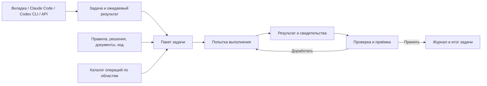

# Домен: ведение разработки и исследований в DocDD

DocDD ведёт работу от намерения до принятого результата. Вкладка локального помощника, Claude Code, Codex CLI и прямой API дают разные способы работать с одним проектом. У задачи общий ID, ожидаемый результат, связанное основание, попытки выполнения, свидетельства и решение о приёмке. Новый чат можно открыть с ID задачи и восстановить состояние из DocDD.

Граница этой карты — разработка фич и исправлений, исследования и описание уже существующего устройства разрешённого проекта. Карта описывает роли, правила и события. Способ запуска модели, транспорт, хранение и развёртывание конкретизируются в System Design.



## Области ответственности

| Область | Чем управляет | Что передаёт другим |
|---|---|---|
| Проект и доступ | Корень проекта, команда, права и разрешённые источники | Идентичность, область и допустимые действия |
| Постановка и готовность | Намерение, задача, критерии, связанные решения и зависимости | Задачу с условиями старта и перечнем пробелов |
| Навигация и знания | Справки, документы, точки входа кода, происхождение и актуальность | Пакет задачи и ссылки на недостающие фрагменты |
| Выполнение | Попытка, исполнитель, режим работы и рабочая область | Патч, исследование либо описание реализации |
| Проверка и приёмка | Свидетельства, покрытие критериев, замечания и решение человека | Принятый результат, возврат на доработку или отклонение |
| Доступные операции | Контракты действий по областям, проверка прав и условий | Доступные операции, результаты вызовов и причины отказов |

## Одна задача через разные каналы

1. Запрос с ID открывает существующую задачу. Запрос без ID сначала ищет совпадение по цели и области. При неоднозначности человек выбирает запись или заводит новую. Новая постановка входит в DocDD черновиком, независимо от выбранного канала.
2. В постановке указываются цель, границы и критерии. Для изменения продукта фиксируются возможность карты, требование, задача и проверка. Для исследования заранее определяется, какие вопросы должны получить ответ и какой документ станет результатом.
3. Для изменения кода DocDD проверяет текущие ворота `ready`, включая подтверждённое основание, закрытые зависимости и правила для типа изменения. Запрос на изучение проекта до готовности может читать разрешённые документы и создавать черновые предложения.
4. Попытка получает ID, исполнителя, режим, основание и рабочую область. Одна активная попытка вправе писать в одну рабочую ветку. Документы исследования и материалы предварительного чтения изолируются от рабочего дерева задачи. При переходе с вкладки на CLI агент получает актуальный пакет, сводку сделанного и оставшиеся шаги по той же задаче.
5. Исполнитель передаёт результат и свидетельства. `in_review` означает готовность к проверке. Положительный отчёт тестов подтверждает прохождение проверки, а приёмка относится к конкретной версии результата. При возврате остаются комментарии и история предыдущей попытки. Новая попытка получает только ещё актуальные материалы.

Два параллельных клиента не получают право на одно и то же изменение версии. При изменении основания до записи или приёмки DocDD возвращает конфликт с изменившимися ссылками и позволяет заново собрать пакет. Повтор запроса после обрыва связи возвращает уже зарегистрированный результат операции по её ключу. Состояния и переходы опираются на действующий [процесс работы](../../08-usage.md) и [исполнение в рабочем дереве](../../09-execution.md).

## Как агент узнаёт, куда идти

**Первый ответ на ID задачи** содержит цель и ожидаемый результат, этап и следующий доступный шаг, применимые инструкции, ключевые решения и проверки, несколько точек входа кода, список разрешённых операций текущего шага, версии источников и отметку об усечении. Если файл упомянут как предположение, ответ явно помечает это. Для каждого обязательного правила сохраняется ссылка на документ, из которого оно взято.

**Порядок поиска** — точные ID, пути, имена и символы → явные связи задачи и справочник → поиск по словам → поиск по смыслу для оставшихся пробелов. Каждый результат содержит путь или ID, заголовок или диапазон, ревизию и причину отбора. Агент может запросить отдельный фрагмент или расширить пакет в пределах доступной области. При недоступном векторном индексе точное и текстовое чтение продолжают работать. Доступ проверяется перед выдачей, в том числе при чтении по старой ссылке.

**Слои инструкций** — общие правила проекта, правила затронутой области и ограничения задачи. Более узкий слой уточняет способ работы. Полномочия и ворота задаёт сервер. Противоречия в правилах или устаревшие точки входа показываются в пакете с источниками. Агент останавливает зависимое изменение до решения конфликта. Привычные входные файлы CLI дают короткий маршрут до DocDD. Подробные инструкции подгружаются по области. Текст из поиска, веба и вложений обрабатывается как материал задачи.

**Описание области** содержит назначение, термины, поддерживаемые действия, публичные входы, ссылки на неё в картах, связанные решения и способы проверки. Например, запрос о допуске задачи к разработке приводит к правилам процесса и тестам переходов. Запрос о пропавшей цитате приводит к области поиска, формату результата и проверке версии источника. Такой каталог переиспользует существующие [справочник](../../13-reference.md), [пакет контекста](../../adr/0021-context-pack.md) и [поиск по блокам](../../adr/0031-semantic-search.md).

## Операции по областям и равенство каналов

| Семейство | Операции, которые нужны в домене | Граница |
|---|---|---|
| Ведение задачи | Найти задачу, собрать пакет, начать или возобновить попытку, сообщить результат | DocDD проверяет состояние задачи и полномочия исполнителя |
| Навигация | Найти документ, символ или модуль, открыть выбранный фрагмент, показать связанные решения | Результаты ограничены проектом, разрешёнными источниками и бюджетом |
| Карты и документы | Прочитать карту, предложить изменение, получить diff и сохранить черновик | Подтверждение привязано к определённым записям и действию |
| Рабочая область и проверки | Получить разрешённую область, приложить патч, запустить разрешённую проверку или зарегистрировать отчёт | Результат связан с конкретной попыткой и ревизией |
| Исследование | Зарегистрировать источник, добавить находку или вывод, предложить решение | Локальный поиск доступен без интернета, веб-ресерч разрешается отдельно |
| Приёмка | Показать критерии и доказательства, вернуть замечания, оформить решение | Решение человека и проверка статуса выполняются через DocDD |

Это перечень доменных действий, часть из которых уже доступна. Например, текущий MCP находит задачи через `next_tasks`, получает пакет через `task_context`, создаёт черновики и принимает подтверждённые действия. У стороны клиента может быть файловое редактирование в выданной рабочей области, но результат и переходы задачи проходят через DocDD. Поддержка каждого семейства и недостающие контракты уточняются при проектировании реализации. [Текущий каталог MCP](../../17-mcp.md)

Для каждой операции в каталоге нужны владелец, назначение, вход и выход, допустимые состояния задачи, необходимая роль, побочные эффекты и ожидаемая ревизия. Короткая выдача содержит имя и назначение действий, которые доступны на текущем шаге. Точные схемы подтягиваются по необходимости. Для клиента с фиксированным списком инструментов достаточно небольшого общего набора чтения каталога, пакета задачи и вызова разрешённой операции. MCP и прямой HTTP API применяют те же доменные проверки, что и вкладка. У MCP сведения для чтения, шаблоны взаимодействия и действия можно представить как ресурсы, промпты и инструменты соответственно.

## Три сценария и их результат

| Сценарий | Рабочий путь | Что принимается |
|---|---|---|
| Фича или дефект | Поднять требования и точку входа, уточнить критерии, провести задачу через ворота, выполнить правку и проверки | Версия изменений, обновлённые записи и проверяемое соответствие критериям |
| Исследование | Уточнить вопрос и границы, найти внутренние решения, при необходимости разрешить веб-поиск, сопоставить источники и варианты | Ответ на вопрос с происхождением данных, выводами, неопределённостью и черновиком решения при необходимости |
| Разбор реализации | Найти точки входа и конфигурацию, проследить существующие вызовы и контракты, сверить наблюдения с разрешённым кодом | Карта и справки с воспроизводимыми свидетельствами, отметками о догадках и пробелах |

Изображение используется как входной материал любой попытки. Для производного описания остаётся ссылка на оригинал. Локальный режим разрешает только локальные модели и источники, пока пользователь отдельно не разрешит веб-ресерч или другой выход за пределы локального контура. Передача задачи между каналами сохраняет решения и журнал, а доступ к вложению проверяется заново.

## Что переходит в System Design

- Каким бы клиентом ни началась задача, все используют один запрос состояния, один пакет задачи и единую проверку команд. Контракт попытки позволяет продолжить работу в другом канале без повторной постановки.
- У поиска разные пути для ID, кода и смысловой близости, но единый формат результата с происхождением, версией и границами доступа.
- У операций есть модуль-владелец и общая политика вызова. У хранилища контекста, попыток и свидетельств разные назначения. Исходные документы остаются источником истины.
- Контур исполнения принимает только разрешённые действия, а контур приёмки проверяет версию, доказательства и явное решение. Группы карты архитектуры нужно уточнять по этим ответственностям и трём пользовательским сценариям. [Текущий черновик System Design](M-0107-ustroystvo-docdd-i-vkladka-llm.md)

## Как проверить домен

1. Открыть одну задачу во вкладке и CLI по её ID. Увидеть ту же цель, ревизию, разрешённые действия и последний результат. Продолжить в другом канале с сохранённого шага.
2. Дать запрос с точным ID решения и именем модуля. Первый пакет указывает на действующее решение, публичный вход и связанную проверку. В оценке сравниваются полнота обязательных ссылок, число вызовов до первого обоснованного действия и объём переданного контекста с текущим `task_context`.
3. Попробовать начать правку неподготовленной задачи через разные каналы. Каждый возвращает причины отказа и ссылки на недостающие записи.
4. Сменить ревизию задачи между получением diff и записью. Первый запрос с прежней ревизией возвращает конфликт. Повтор уже успешно применённой команды с тем же ключом не дублирует запись.
5. Провести три сценария до приёмки. Для каждого результата восстановить цепочку от источников и постановки до свидетельства и решения человека. Для исследования отдельно проверить работу без интернета и явное включение веб-ресерча.

## Что взято из похожих решений

- Claude Code разделяет постоянные инструкции проекта и навыки с загрузкой по мере необходимости. Для DocDD применим аналогичный подход: короткий вход и подробности из области задачи. [Инструкции Claude Code](https://code.claude.com/docs/en/memory) · [Skills](https://code.claude.com/docs/en/skills)
- Codex считывает `AGENTS.md` по области каталогов. В DocDD эту идею дополняет доменная привязка: пакет определяется задачей и затронутыми областями, включая случаи, когда одна область разбросана по каталогам. [Правила AGENTS.md](https://learn.chatgpt.com/docs/agent-configuration/agents-md)
- GitHub Copilot принимает работу из issue и отдаёт человеку результат на рассмотрение. В DocDD тот же принцип применяется отдельно к патчу, исследованию и карте текущего устройства. [Постановка задачи агенту GitHub](https://docs.github.com/en/copilot/how-tos/copilot-on-github/use-copilot-agents/kick-off-a-task)
- MCP описывает обнаружение возможностей и различает ресурсы, промпты и инструменты. Для DocDD это основа каталога с правами и областями, а состояние задачи остаётся в DocDD. [Архитектура MCP](https://modelcontextprotocol.io/docs/2026-07-28/learn/architecture)

```docdd-domain
{
  "added": {
    "nodes": [
      {
        "id": "dev.project",
        "kind": "context",
        "title": "Проект",
        "summary": "Граница документов, кода, прав и задач."
      },
      {
        "id": "dev.people",
        "kind": "actor",
        "title": "Участники проекта",
        "summary": "Автор, исполнитель и принимающий действуют с правами своей роли. Один человек может выполнять несколько ролей."
      },
      {
        "id": "dev.channel",
        "kind": "concept",
        "title": "Канал работы",
        "summary": "Вкладка, Claude Code, Codex CLI или прямой HTTP API обращаются к одной задаче.",
        "sysdesign": [
          "local-assistant.tab",
          "server.http",
          "server.mcp"
        ]
      },
      {
        "id": "dev.executor",
        "kind": "actor",
        "title": "Исполнитель попытки",
        "summary": "Человек, локальная модель или внешний харнес ведёт назначенную попытку в её границах.",
        "sysdesign": [
          "local-assistant.session",
          "external.harness"
        ]
      },
      {
        "id": "dev.intent",
        "kind": "concept",
        "title": "Намерение",
        "summary": "Входящее описание задачи, исследования, разбора реализации или дефекта.",
        "sysdesign": [
          "server.inbox"
        ]
      },
      {
        "id": "dev.routing",
        "kind": "process",
        "title": "Подготовка задачи",
        "summary": "Уточняет цель, исключения и ожидаемый результат, связывает существующие документы и отмечает пробелы.",
        "sysdesign": [
          "server.inbox"
        ]
      },
      {
        "id": "dev.task",
        "kind": "aggregate",
        "title": "Задача DocDD",
        "summary": "Одна запись задачи с ожидаемым результатом, ответственностью, зависимостями и журналом.",
        "sysdesign": [
          "server.validation",
          "server.work"
        ]
      },
      {
        "id": "dev.baseline",
        "kind": "concept",
        "title": "Основание работы",
        "summary": "Актуальные требования, решения, контракты, карта, проверки и ревизии записей, на которые опирается задача."
      },
      {
        "id": "dev.gate",
        "kind": "rule",
        "title": "Готовность к изменению",
        "summary": "Код меняется по готовой задаче и действующему подтверждённому основанию. Проверка готовности принадлежит DocDD.",
        "sysdesign": [
          "server.validation"
        ]
      },
      {
        "id": "dev.profile",
        "kind": "concept",
        "title": "Входные инструкции",
        "summary": "Короткие правила проекта, области и задачи со ссылками, версией и порядком применения."
      },
      {
        "id": "dev.module",
        "kind": "concept",
        "title": "Область проекта",
        "summary": "Владелец обязанности, смысловые границы, публичные входы, справки и способы проверки. Может соответствовать нескольким каталогам."
      },
      {
        "id": "dev.source",
        "kind": "concept",
        "title": "Источник знания",
        "summary": "Документ, раздел, путь или символ кода с происхождением и ревизией. Внешний источник имеет URL и дату доступа.",
        "sysdesign": [
          "server.files",
          "server.read"
        ]
      },
      {
        "id": "dev.search",
        "kind": "process",
        "title": "Поиск по проекту",
        "summary": "Разрешает точные идентификаторы, имена и пути, дополняет их поиском по словам и смыслу.",
        "sysdesign": [
          "server.search",
          "local-assistant.retrieve"
        ]
      },
      {
        "id": "dev.packet",
        "kind": "concept",
        "title": "Пакет задачи",
        "summary": "Ограниченный по бюджету набор цели, правил, решений, входов, проверок и доступных действий со ссылками.",
        "sysdesign": [
          "server.search",
          "local-assistant.retrieve"
        ]
      },
      {
        "id": "dev.directory",
        "kind": "concept",
        "title": "Каталог операций",
        "summary": "Описывает возможности по областям, версии контрактов, условия вызова и побочные эффекты.",
        "sysdesign": [
          "server.mcp",
          "local-assistant.mcp"
        ]
      },
      {
        "id": "dev.authority",
        "kind": "rule",
        "title": "Полномочия попытки",
        "summary": "Проект, задача, исполнитель и операция сверяются при каждом вызове. Переход канала не расширяет доступ.",
        "sysdesign": [
          "server.http",
          "server.mcp"
        ]
      },
      {
        "id": "dev.attempt",
        "kind": "aggregate",
        "title": "Попытка выполнения",
        "summary": "Отдельный запуск задачи с исполнителем, каналом, основанием, рабочей областью и событиями.",
        "sysdesign": [
          "server.local",
          "server.jobs"
        ]
      },
      {
        "id": "dev.area",
        "kind": "concept",
        "title": "Рабочая область",
        "summary": "Рабочее дерево задачи для кода или папка сессии для материалов. Результаты возвращаются в DocDD.",
        "sysdesign": [
          "server.work",
          "local-assistant.workspace"
        ]
      },
      {
        "id": "dev.feature",
        "kind": "process",
        "title": "Разработка изменения",
        "summary": "Патч, обновлённые документы и карта, результаты проверок и открытые вопросы.",
        "sysdesign": [
          "server.local.feature"
        ]
      },
      {
        "id": "dev.research",
        "kind": "process",
        "title": "Исследование",
        "summary": "Вопрос, проверенные источники, выводы и варианты решений. Веб-поиск включается отдельно.",
        "sysdesign": [
          "server.local.research",
          "local-assistant.research"
        ]
      },
      {
        "id": "dev.reverse",
        "kind": "process",
        "title": "Разбор реализации",
        "summary": "Описание собственного или разрешённого проекта по путям, символам, контрактам и наблюдаемому поведению.",
        "sysdesign": [
          "server.local.reverse",
          "server.maps"
        ]
      },
      {
        "id": "dev.attachment",
        "kind": "concept",
        "title": "Вложение",
        "summary": "Изображение или документ, привязанные к проекту и попытке. Производный материал ссылается на оригинал.",
        "sysdesign": [
          "local-assistant.vision",
          "local-assistant.workspace"
        ]
      },
      {
        "id": "dev.result",
        "kind": "concept",
        "title": "Кандидат результата",
        "summary": "Патч, отчёт исследования либо описание реализации с привязкой к попытке и основанию."
      },
      {
        "id": "dev.evidence",
        "kind": "concept",
        "title": "Свидетельство",
        "summary": "Ссылка на версию источника, отчёт проверки или наблюдение, подтверждающее конкретное утверждение."
      },
      {
        "id": "dev.review",
        "kind": "process",
        "title": "Приёмка результата",
        "summary": "Человек сопоставляет результат и свидетельства с ожидаемым результатом.",
        "sysdesign": [
          "server.work",
          "server.validation"
        ]
      },
      {
        "id": "dev.approval",
        "kind": "rule",
        "title": "Адресное подтверждение",
        "summary": "Подтверждение относится к конкретным документам, действию и проверенной версии результата.",
        "sysdesign": [
          "local-assistant.mcp",
          "server.validation"
        ]
      },
      {
        "id": "dev.journal",
        "kind": "concept",
        "title": "Журнал задачи",
        "summary": "Фиксирует автора, попытку, существенные события, результат и решение о приёмке.",
        "sysdesign": [
          "server.records",
          "server.jobs"
        ]
      },
      {
        "id": "dev.closed",
        "kind": "event",
        "title": "Задача принята",
        "summary": "Решение человека и доказательства связаны с конкретным результатом. Статус закрытия выставляет DocDD."
      }
    ],
    "edges": [
      {
        "from": "dev.project",
        "to": "dev.task",
        "type": "owns",
        "summary": "Задачи живут в проекте"
      },
      {
        "from": "dev.project",
        "to": "dev.module",
        "type": "owns",
        "summary": "Каталог областей проекта"
      },
      {
        "from": "dev.project",
        "to": "dev.source",
        "type": "owns",
        "summary": "Разрешённые источники проекта"
      },
      {
        "from": "dev.people",
        "to": "dev.intent",
        "type": "owns",
        "summary": "Формулирует намерение"
      },
      {
        "from": "dev.channel",
        "to": "dev.routing",
        "type": "causes",
        "summary": "Ввод или поиск существующей задачи"
      },
      {
        "from": "dev.intent",
        "to": "dev.routing",
        "type": "causes",
        "summary": "Цель и исходный запрос"
      },
      {
        "from": "dev.routing",
        "to": "dev.task",
        "type": "causes",
        "summary": "Черновая или уточнённая задача"
      },
      {
        "from": "dev.task",
        "to": "dev.baseline",
        "type": "owns",
        "summary": "Прослеживаемые требования, решения и проверки"
      },
      {
        "from": "dev.gate",
        "to": "dev.attempt",
        "type": "constrains",
        "summary": "Разрешает изменение кода при готовности задачи"
      },
      {
        "from": "dev.task",
        "to": "dev.attempt",
        "type": "owns",
        "summary": "Попытки с одним ID задачи"
      },
      {
        "from": "dev.executor",
        "to": "dev.attempt",
        "type": "owns",
        "summary": "Назначенный исполнитель"
      },
      {
        "from": "dev.authority",
        "to": "dev.directory",
        "type": "constrains",
        "summary": "Разрешения на вызов операций"
      },
      {
        "from": "dev.authority",
        "to": "dev.search",
        "type": "constrains",
        "summary": "Права на документ, путь и область"
      },
      {
        "from": "dev.module",
        "to": "dev.profile",
        "type": "owns",
        "summary": "Правила и точки входа области"
      },
      {
        "from": "dev.module",
        "to": "dev.directory",
        "type": "owns",
        "summary": "Операции области"
      },
      {
        "from": "dev.profile",
        "to": "dev.packet",
        "type": "relates",
        "summary": "Применимые инструкции"
      },
      {
        "from": "dev.baseline",
        "to": "dev.packet",
        "type": "relates",
        "summary": "Подтверждённые основания задачи"
      },
      {
        "from": "dev.source",
        "to": "dev.search",
        "type": "relates",
        "summary": "Текст, метаданные и версия"
      },
      {
        "from": "dev.search",
        "to": "dev.packet",
        "type": "causes",
        "summary": "Точные ссылки и релевантные фрагменты"
      },
      {
        "from": "dev.directory",
        "to": "dev.packet",
        "type": "relates",
        "summary": "Имена допустимых операций и ссылки на контракты"
      },
      {
        "from": "dev.attempt",
        "to": "dev.packet",
        "type": "owns",
        "summary": "Пакет для текущего шага"
      },
      {
        "from": "dev.attempt",
        "to": "dev.area",
        "type": "owns",
        "summary": "Изолированные рабочие материалы"
      },
      {
        "from": "dev.area",
        "to": "dev.feature",
        "type": "relates",
        "summary": "Рабочее дерево задачи"
      },
      {
        "from": "dev.attachment",
        "to": "dev.research",
        "type": "relates",
        "summary": "Локальный анализ приложенного материала"
      },
      {
        "from": "dev.feature",
        "to": "dev.result",
        "type": "causes",
        "summary": "Патч и документы"
      },
      {
        "from": "dev.research",
        "to": "dev.result",
        "type": "causes",
        "summary": "Выводы и источники"
      },
      {
        "from": "dev.reverse",
        "to": "dev.result",
        "type": "causes",
        "summary": "Карта того, как система устроена"
      },
      {
        "from": "dev.result",
        "to": "dev.evidence",
        "type": "owns",
        "summary": "Свидетельства для проверки вывода или патча"
      },
      {
        "from": "dev.result",
        "to": "dev.review",
        "type": "causes",
        "summary": "Результат готов к разбору"
      },
      {
        "from": "dev.approval",
        "to": "dev.review",
        "type": "constrains",
        "summary": "Решение относится к указанной версии результата"
      },
      {
        "from": "dev.review",
        "to": "dev.closed",
        "type": "causes",
        "summary": "Приёмка при выполненных критериях"
      },
      {
        "from": "dev.review",
        "to": "dev.attempt",
        "type": "causes",
        "summary": "При возврате создаётся новая попытка"
      },
      {
        "from": "dev.task",
        "to": "dev.journal",
        "type": "owns",
        "summary": "История решений и результата"
      }
    ]
  }
}
```

## Журнал

- 2026-11-24 · создан черновик доменной карты единого процесса разработки · Codex
- 2026-11-24 16:49 · на подтверждение · architect
- 2026-11-24 16:49 · подтверждён · architect
